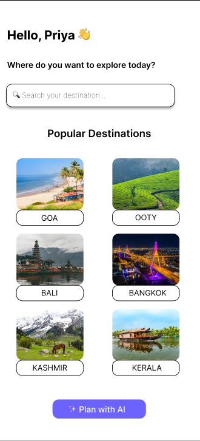
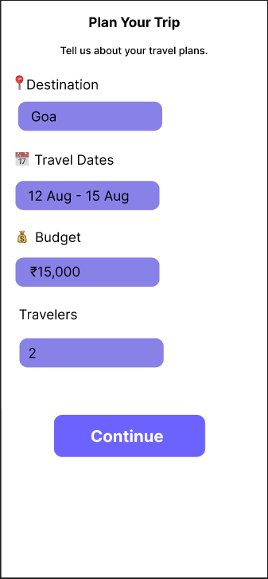
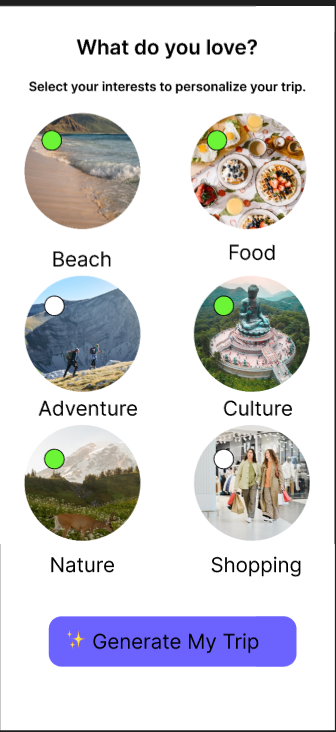
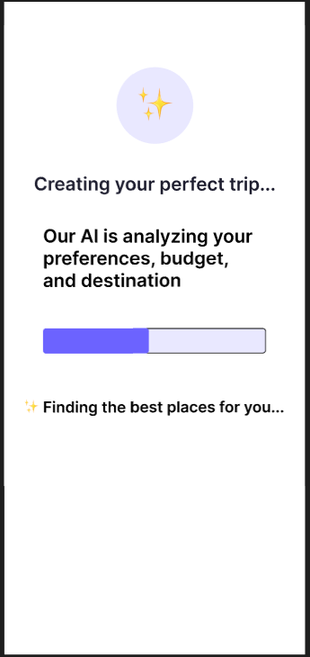
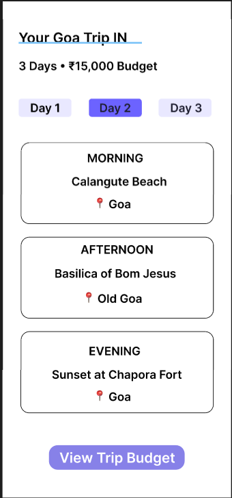

# ✈️ TripGenie AI — UI/UX Design Project

### AI-Powered Personalized Travel Planner

## 📌 About the Project

TripGenie AI is a UI/UX design project created in Figma to help users plan personalized trips based on their destination, budget, interests, and travel preferences.

The goal is to make travel planning simple, convenient, and personalized through an AI-powered experience.

## 🎯 Problem Statement

Planning a trip can be time-consuming because users need to research destinations, manage budgets, and organize activities.

TripGenie AI aims to simplify this process by generating personalized travel itineraries.

## 💡 Solution

The proposed application allows users to:

* Enter their travel destination and preferences.
* Set their travel budget.
* Select interests such as beaches, food, and adventure.
* Generate a personalized itinerary.
* View daily travel plans.
* Explore estimated trip expenses.
* Save their planned trips.

## 🎨 Design Process

1. User Research
2. User Flow
3. Wireframes
4. Design System
5. Final UI Design
6. Interactive Prototype
7. Case Study

## 🛠️ Tools Used

* Figma
* UI/UX Design
* Wireframing
* Prototyping
* User Flow
* Design Systems

## 📱 Sample Trip

**Destination:** Goa, India

**Duration:** 3 Days

**Planned Budget:** ₹15,000

The itinerary includes beaches, historical attractions, local food experiences, and shopping.

## 🔗 View the Figma Project

[Click here to view the TripGenie AI design and prototype](https://www.figma.com/design/daUCVbpTQQzQXe0DO3uOpM/AI-Powered-travel-planner?node-id=3-6&t=vkUweIJn8PhU6wx3-1)

## 👩‍💻 Project Information

**Project Name:** TripGenie AI

**Role:** UI/UX Designer

**Project Type:** Individual Project

**Year:** 2026
## 🖼️ UI Screenshots

### Home Screen

### Plan a Trip

### AI Loading Screen

### Personalized Itinerary

### Budget Screen

